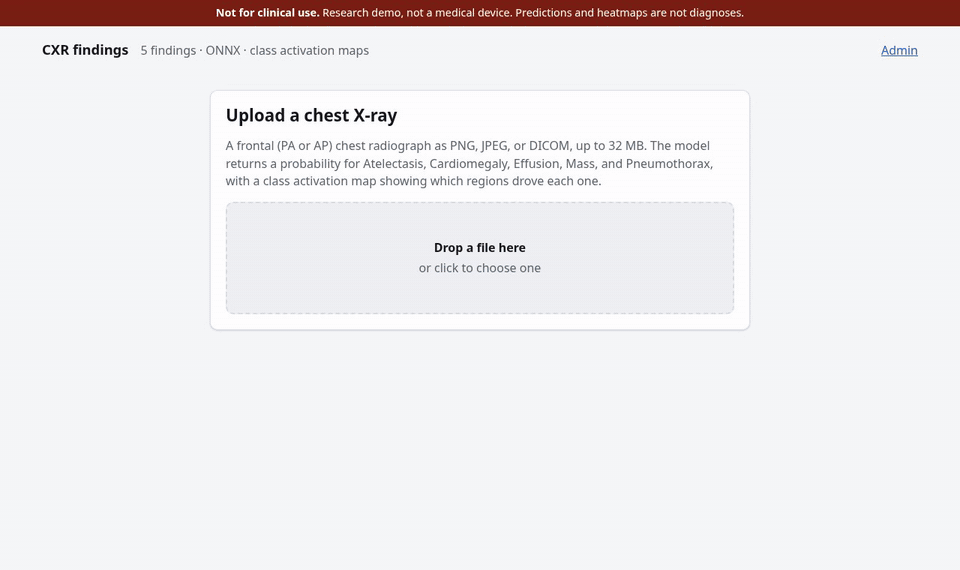
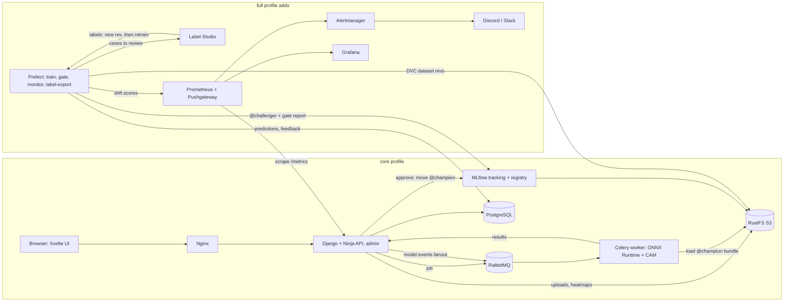

# full-stack-on-prem-cxr-mlops

Chest X-ray abnormality classification with per-class probabilities and a CAM heatmap, from versioned data to label-driven retraining, all on-prem in Docker Compose.

> **Not a medical device.** This is a portfolio project. It is not clinically validated and must not be used for diagnosis.



What it shows, end to end on a laptop CPU:

- **Serving:** upload a chest X-ray in the browser and get per-class probabilities and a class activation map from the `@champion` model, without training anything. Every prediction records its model version, MLflow run, and DVC dataset rev.
- **Training and promotion:** a Prefect flow trains, evaluates, exports ONNX, and checks PyTorch-vs-ONNX parity on raw golden files. A paired bootstrap gate compares each new version with `@champion` on a frozen locked test set. A person approves it in Django admin, and every worker switches to the new version between jobs.
- **Monitoring and the labeling loop** (`full` profile): drift per model version with Evidently, delayed AUROC from reviewer feedback, and alerts through Prometheus to Discord or Slack. Disagreements and drifted cases go to Label Studio, the labels come back as a new DVC revision, and enough new labels start a retrain. `make demo` plays that whole loop with no clicks.

## Quickstart: upload → heatmap

Requires Docker with Compose v2, GNU make, and an internet connection for the first build. No GPU, no uv, and no dataset download (`make smoke` uses the system `python3`).

```sh
git clone https://github.com/discdetsu/med-mlops.git && cd med-mlops
make up           # core profile: builds and starts everything, waits until healthy
make seed-model   # downloads the released seed model and registers it as @champion
```

Open http://localhost:8000 and upload a frontal chest X-ray (PNG, JPEG, or DICOM). [`docs/samples/`](docs/samples/README.md) has three NIH images to try. The page shows the image with a heatmap for the selected finding, the probability of each of the five findings against its threshold, a feedback form, and which model version, dataset rev, and MLflow run produced the result. Django admin is at http://localhost:8000/admin/ (`DJANGO_ADMIN_USER` / `DJANGO_ADMIN_PASSWORD` from `.env`). `make smoke` runs the same flow with curl, and `make down` stops everything.

`make seed-model` downloads `SEED_BUNDLE`, the [`seed-v2` release](https://github.com/discdetsu/med-mlops/releases/tag/seed-v2), checks it against its `.sha256`, and registers it in the local MLflow. When a `@champion` already exists it does nothing; add `SEED_MODEL_ARGS=--force` to register the bundle anyway. A bundle you built yourself with `make bootstrap-champion` works too: `make seed-model SEED_BUNDLE=dist/cxr-seed-bundle-v2.tar.gz`. A fresh MLflow registers the seed model as version 1, which is the version the UI shows; its `origin_model_version` lineage tag (2) is the version the [model card](docs/model-card.md) describes.

### What it needs

Measured on 2026-11-12 on a laptop (Linux, 16 GB RAM, no GPU) from a fresh clone, with images built with `--no-cache`. RAM is the sum of `docker stats` over the stack's containers after a few uploads, idle between jobs.

| | `core` | `full` |
| --- | --- | --- |
| RAM, idle | 1.5 GiB | 3.3 GiB |
| Docker images | 4.2 GB | 15.3 GB (includes `core`) |
| Volumes after seeding | 0.3 GB | 0.5 GB |
| First `make up` | 3.5 min (2.7 min build, 45 s start) | adds the Prefect, Label Studio, monitoring, and flows images (torch for training) |

Largest containers: under `core` the worker (about 360 MiB with the model loaded), MLflow (300 to 500 MiB), and RustFS (about 300 MiB); `full` adds flows-worker (about 620 MiB idle), Grafana (about 520 MiB), the monitor (about 360 MiB), and Label Studio (about 340 MiB). Training runs on top of that, in the host process for `make train` or in flows-worker for a retrain, and wasn't measured here. Training on the full NIH dataset also takes about 45 GB in RustFS, plus the DVC workspace and cache on the host (up to as much again, less where the filesystem shares them through reflinks). The default `make seed` subset is about 1.6 GB.

## Architecture



[`architecture_v2.html`](architecture_v2.html) has the detailed poster, and [`implementation-plan_v2.md`](implementation-plan_v2.md) has the build plan with what was checked at each phase.

How a request flows: Nginx → Django stores the upload in RustFS and queues a job on RabbitMQ → a Celery worker (ONNX Runtime, no torch) runs `cxr_core.preprocess` → ONNX → CAM and posts the result back → the UI polls for it. When `@champion` moves, a `model.events` fanout tells every worker to load the new version between jobs. Jobs that can never succeed go to the `dlq` queue. See [ADR 0005](docs/adr/0005-async-inference-queue.md).

## Training and development

Also requires [uv](https://docs.astral.sh/uv/).

```sh
make install          # uv workspace (Python 3.14) + pre-commit hooks
make test             # unit + API contract tests
make test-integration # against `make up`: RustFS, MLflow, DVC, RabbitMQ, app tables, gateway
make seed             # NIH subset from Kaggle → validate → DVC add + push → Postgres
make train            # train → evaluate → ONNX → E2E parity → reference → @challenger → gate
make gate VERSION=N   # re-run the promotion gate for a version (default: @challenger)
make bootstrap-champion  # first model → @champion, seed bundle in dist/
make up PROFILE=full  # + Prefect, Label Studio, Prometheus, Alertmanager, Pushgateway, Grafana,
                      #   monitor, flows-worker
make monitor          # one monitor pass (PROFILE=full also pushes the scores to Prometheus)
make label-export     # Label Studio annotations → data/curated → new DVC rev → should_retrain()
make demo             # the whole loop on the full stack: drift → labels → retrain → gate → promote
make test-rules       # promtool: Prometheus config check + alert rule unit tests
make help             # all targets
```

`make seed` fetches 4,000 images (≈1.6 GB, about 30 minutes) one file at a time from the public [Kaggle mirror](https://www.kaggle.com/datasets/nih-chest-xrays/data) of NIH ChestX-ray14; no Kaggle token is needed. If you already have the full dataset unpacked, `make seed SEED_ARGS="--from-archive /path/to/dataset"` copies from it instead (seconds for the default subset; about 17 minutes for all 112k images with `--positives-per-class all --negatives all`, most of it `dvc push`); `--from-archive` alone downloads the 45 GB archive once (see [`data/README.md`](data/README.md)). `make train` uses the `demo` profile (ResNet18 at 128 px, trained on a fixed 4,000-image sample of the train split): about 30 minutes on a laptop CPU with the full dataset pinned, most of it scoring the 16k val images every epoch and the 16.6k `test_locked` images at the end. `make train CONFIG=full` uses DenseNet121 at 320 px; its float32 tensor cache needs about 1.2 MB per image, so on the full dataset it doesn't fit on most disks (about 140 GB). Both flows run without a Prefect server under `core`; with `PROFILE=full` they report to the Prefect UI. After a seed, commit the DVC pointers: `git add data/*.dvc && git commit`.

The committed pointers pin the full NIH dataset, and its files live only in the DVC remote they were pushed to: the `datasets` bucket on the RustFS of the machine that seeded them. A fresh clone starts with an empty RustFS, so `make seed` and `make train` stop with `PinnedDataMissingError`, because the frozen `test_locked` can't be regenerated. Either copy that bucket's contents in from the machine that has them, or delete `data/*.dvc` and run `make seed` to start a dataset of your own, with its own locked test set (its models are only comparable with each other).

## Promotion: gate → approve → every worker switches

`make train` ends with the promotion gate: the new `@challenger` and the current `@champion` score the same 16.6k-image locked test set through their ONNX bundles, and a paired bootstrap over patients puts a CI on each AUROC difference. The gate passes when macro AUROC is non-inferior (lower 95% bound of the difference ≥ −0.02), no sex, view, or age subgroup drops by more than 0.02, ECE rises by at most 0.01, and E2E parity passed; the thresholds live in [`gate.yaml`](flows/src/cxr_flows/configs/gate.yaml). It takes about 3 minutes on a laptop CPU. See [ADR 0007](docs/adr/0007-human-promotion-gate.md).

The result waits in Django admin under **Registry → Model candidates**, with the full report. **Approve** (needs a reason) moves `@champion` to the new version and the old one to `@previous`, then tells every worker to load it after its current job. **Reject** closes the candidate. **Roll back** on the list page moves `@champion` back to `@previous`. Each decision is logged in **Model approvals**. A candidate can only be approved while `@champion` is still the version it was compared with; otherwise `make gate VERSION=N` re-runs the comparison. The same actions work without the admin: `make promote VERSION=N REASON="..."` and `make rollback REASON="..."`. With `auto_promote: true` in `gate.yaml`, `make train` approves a passing version by itself (for the scripted demo).

Checking that a promotion reaches every worker:

```sh
docker compose --profile core up -d --scale worker=2
make gate VERSION=N   # or make train; then approve version N in the admin
make smoke            # repeat a few times: each prediction must come from version N
                      # then roll back in the admin
make smoke            # predictions come from the previous champion again
```

## Monitoring: drift → alert

Under `make up PROFILE=full`, the `monitor` service runs the monitor flow every 5 minutes (it shows up in Prefect as the `monitor/monitor` deployment). For each model version, it takes the newest 200 predictions of the last hour, counting each uploaded file once, and compares them with that version's own drift reference with [Evidently](https://github.com/evidentlyai/evidently). The reference is its validation set, stored in its bundle. Three things are compared:

- embeddings: can a classifier tell them apart (ROC AUC);
- each class probability;
- sex, age, and view, from the upload's form fields or its DICOM header.

From 30 labeled predictions it also reports AUROC against reviewer feedback, with a bootstrap CI. Scores go to Prometheus through the Pushgateway, each report to Django admin under **Monitoring → Drift reports** (with the full Evidently page), and alerts to Discord or Slack. It never retrains: only new labels do (below). Thresholds live in [`monitor.yaml`](flows/src/cxr_flows/configs/monitor.yaml), and [ADR 0008](docs/adr/0008-monitoring-drift-and-alerts.md) has the reasoning and the calibration.

Grafana (http://localhost:3000, `admin` / `GRAFANA_ADMIN_PASSWORD`) has three provisioned dashboards: **CXR · Serving** (API and workers), **CXR · Queue** (RabbitMQ, DLQ), and **CXR · Model** (per version: what serves, drift against thresholds, delayed AUROC, and the labeling loop's tasks and new labels). Alerts: API error rate, backend down, no worker, non-empty DLQ, drift above threshold, and a stale or never-run monitor. To get them in a channel, set `DISCORD_WEBHOOK_URL` or `SLACK_WEBHOOK_URL` in `.env` before `make up`; without either, they are listed at http://localhost:9093.

The drift demo needs the NIH images on disk (`make seed` or `dvc pull data/nih`) and a `@champion`:

```sh
make up PROFILE=full
make replay ARGS="--n 150 --feedback 0.4"   # validation images with NIH metadata; NIH labels as feedback
make inject-drift ARGS="--n 200"            # AP views only (37% of the reference)
# within 5 minutes, or right away with `make monitor PROFILE=full`:
#   CXR · Model shows embedding and view drift above threshold, and CxrDriftDetected is sent
docker compose --profile full stop monitor  # CxrMonitorStale fires about 16 minutes later
```

Checked on 2026-11-01 against the `full` stack with the v2 champion. 150 validation images scored embedding 0.48 (threshold 0.6) and view 0.006 (threshold 0.2), with no drift. Their 45 labels gave a delayed macro AUROC of 0.64 (95% CI 0.51 to 0.82). Then 200 AP views scored embedding 0.76 and view 0.54, and both `CxrDriftDetected` alerts reached the webhook. With the monitor stopped, `CxrMonitorStale` fired after 16 minutes. A pass takes about 10 s on a laptop CPU.

## Labeling loop: labels → new data → retrain

Each monitor pass also sends cases to review in Label Studio (http://localhost:8080, `LABEL_STUDIO_USERNAME` / `LABEL_STUDIO_PASSWORD`, project **CXR review**): predictions a reviewer disagreed with in the feedback form, the 25 farthest from the reference in any window that drifted, and a small random sample. Reviewers see the image and the five findings, never the model's answer. A case needs a patient ID, sent as the `patient_id` upload field or read from the DICOM header, because that is how the locked test set stays protected; the UI's plain PNGs don't have one, so they can't enter the loop.

The `flows-worker` service exports finished annotations every 15 minutes (`make label-export` runs one):

- Each answer is checked with Pandera. One that fails, such as a patient in `test_locked`, an expired upload, or missing sex or view, is quarantined with its reason under **Labeling → Labeling tasks** in Django admin, and never reaches the data.
- The rest go to `data/curated/`, which makes a new `dataset_rev` (`dvc add` + `dvc push`, `labels` with `label_source=reviewer`). Commit the pointer with `git add data/curated.dvc && git commit`.
- A patient's labels go to `train`, or to `recent`, a slice held back from training and reported in each version's evaluation.
- `should_retrain()` starts the `train/retrain` deployment on a new rev with at least 50 new training labels (`min_new_labels` in [`labeling.yaml`](flows/src/cxr_flows/configs/labeling.yaml)). Every decision, either way, is under **Labeling → Retrain decisions**. Drift alone never starts one.

A retrain runs in `flows-worker` on the repo itself, ends with the promotion gate, and waits for approval in the admin like any other version. See [ADR 0009](docs/adr/0009-label-driven-retraining.md).

`make demo` plays all of it with no clicks. It needs the `full` stack, a `@champion`, and the NIH images on disk:

```sh
make up PROFILE=full
make seed-model
make demo   # DEMO_ARGS="--n 200 --feedback 0.6"; about 40 minutes on a laptop CPU
```

It sends AP views the champion didn't train on, with NIH labels as feedback on some of them. The monitor flags the drift and selects cases, the NIH labels stand in for a reviewer through Label Studio's API, the export makes a new rev, and the retrain runs and is gated. `auto_promote` is on for that run only. If the gate passes, the demo checks that a new upload is predicted by the new version on the new rev; if not, it stops there with the gate report. It leaves `data/curated/` and a staged `data/curated.dvc` behind, and moves `@champion` in that stack's MLflow.

`make up` copies `.env.example` to `.env` on first run. Change the passwords there for anything other than a local demo.

| Service | URL | Profile |
| --- | --- | --- |
| Web UI and API (Nginx) | http://localhost:8000 | core |
| Django admin | http://localhost:8000/admin/ | core |
| MLflow | http://localhost:5000 | core |
| RustFS console | http://localhost:9001 | core |
| RabbitMQ management | http://localhost:15672 | core |
| Prefect | http://localhost:4200 | full |
| Label Studio | http://localhost:8080 | full |
| Grafana | http://localhost:3000 | full |
| Prometheus | http://localhost:9090 | full |
| Alertmanager | http://localhost:9093 | full |
| Pushgateway | http://localhost:9091 | full |

All ports bind to `127.0.0.1` only. Django has no published port: browsers reach it through Nginx, and its `/internal` API (for workers) and `/metrics` stay on the compose network, as do the workers' `/metrics` and the `monitor` and `flows-worker` services.

## Repository layout

```
compose/               config mounted into compose services (one folder per service)
  postgres/init/         creates app, mlflow, prefect, labelstudio DBs, one user each
  rustfs/init.sh         buckets + inference/raw/ lifecycle rule
  rabbitmq/              plugins, model.events fanout, dlx → dlq, dead-letter policy
  mlflow/                MLflow server image (Postgres backend, RustFS artifacts)
  nginx/                 gateway: UI, /api, /admin; rate and upload limits
  prometheus/            scrape config, alert rules (rules/), promtool tests (tests/)
  alertmanager/          receiver template + entrypoint: Discord or Slack webhook from .env
  grafana/               provisioning and the three dashboards as JSON
packages/cxr_core/     shared preprocess / ONNX inference / CAM / metrics / bundle / registry names
                       (numpy only); model factory behind [train]
backend/               Django + Ninja: jobs, feedback, registry (champion, seed_model, promotion
                       admin), monitoring (/metrics, drift reports in admin), labeling (tasks and
                       retrain decisions in admin)
worker/                Celery ONNX inference worker, no Django, no torch
flows/                 Prefect flows: ingest, train, promotion (gate), monitor (drift + delayed
                       AUROC + cases for review), label-export (labels → DVC rev → should_retrain);
                       Dockerfile builds the monitor service, without torch, and flows-worker
  src/cxr_flows/configs/ training profiles (demo, full), gate.yaml, monitor.yaml, labeling.yaml
frontend/              Svelte + Vite UI, built into the nginx image
data/                  DVC-tracked datasets; only .dvc pointers are committed
scripts/               download_nih.py, bootstrap_champion.py, smoke_core.sh, wait_healthy.sh,
                       replay_traffic.py, inject_drift.py, demo.py
tests/integration/     tests against the running core stack
docs/adr/              architecture decision records
docs/model-card.md     data, classes, metrics, limitations
docs/samples/          three NIH images to try the UI with
```

## Decisions

One ADR per decision in [`docs/adr/`](docs/adr/README.md): RustFS as the object store, the `core`/`full` profiles, the patient split and locked test set, ONNX with GAP + linear heads so CAM is exact, the async queue, the human promotion gate, drift monitoring, label-driven retraining, and publishing the seed weights. The model, its data, metrics, and limitations are in the [model card](docs/model-card.md).

## Limitations

- **Not a medical device.** No clinical validation, no regulatory review, and the UI says so on every page. The heatmaps show where the model looked, not where the finding is.
- **The model is a pipeline demo.** The seed model is ResNet18 at 128 px trained on CPU with 5% of the training images. Macro AUROC on the locked test set is 0.708, below published NIH baselines, and it is much worse on AP views (0.642) than on PA views (0.740). See the [model card](docs/model-card.md).
- **NIH labels are noisy:** they were mined from radiology reports by NLP and come from one institution, which caps every metric here and says nothing about other scanners or populations.
- **Training needs the pinned data.** The committed DVC pointers pin a dataset that lives only in the RustFS of the machine that seeded it, so a fresh clone can serve and promote but has to `make seed` its own dataset, with its own locked test set, before it can train (see below).
- **Single node, no HA:** one Postgres, one RustFS, one RabbitMQ. Workers scale (`--scale worker=N`), the rest doesn't.
- **Auth is Django's built-in only**, the API has no per-user auth, and `.env.example` ships local passwords. Change them for anything other than a laptop demo.
- **Not exercised end to end:** a person labeling in the Label Studio UI (`make demo` labels through its API), and shadow mode and a per-image OOD flag, which were cut.

## License and data

- **Code:** [MIT](LICENSE).
- **Seed model weights** ([`seed-v2` release](https://github.com/discdetsu/med-mlops/releases/tag/seed-v2)): trained on NIH ChestX-ray14 and distributed under the dataset's terms, with its attribution. Redistribute them with the same attribution. See [ADR 0010](docs/adr/0010-publish-seed-weights.md).
- **Data:** NIH ChestX-ray14, provided by the **NIH Clinical Center**, https://nihcc.app.box.com/v/ChestXray-NIHCC. The dataset's terms place no restrictions on use but require a link to that site, acknowledgement of the NIH Clinical Center, and the citation below. The repo includes only the three sample images in [`docs/samples/`](docs/samples/README.md); `make seed` downloads the rest from the public Kaggle mirror.

> Wang X, Peng Y, Lu L, Lu Z, Bagheri M, Summers RM. ChestX-ray8: Hospital-scale Chest X-ray Database and Benchmarks on Weakly-Supervised Classification and Localization of Common Thorax Diseases. IEEE CVPR 2017, pp. 3462–3471.
