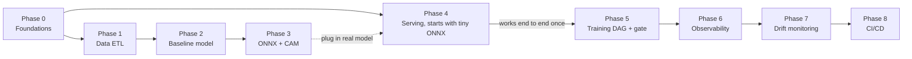

# Lung CXR MLOps: Implementation Plan

Last updated: 2026-10-23

## Diagram v2 review

Diagram v2 is ready to implement. Nothing in the structure needs to be reworked. The core pieces are in place: image data separated from metadata, patient-level splits, a promotion gate with human approval, async serving with a DLQ, drift alerts that go to a human before any retrain, and CI/CD.

The remaining gaps are small, and each one is owned by a phase:

| Gap | Impact | Fixed in |
| --- | --- | --- |
| No step to reload workers after a model is promoted | Medium: workers keep serving the old model and nobody notices | Phase 5 |
| No alerts defined yet for the DLQ and queue depth | Medium: jobs get stuck or fail silently | Phase 6 |
| No backup for Postgres and RustFS | Medium: losing the MLflow registry and manifests | Backlog |
| Uploaded images are patient data, but there is no auth, encryption, or retention policy | High for real use, low for a demo | Backlog |
| Gateway to RustFS/Postgres and drift_job reading Parquet are not drawn as edges (they are in notes) | Low: diagram clarity only | No change needed |
| Training GPU location not decided | Must be decided before Phase 2 | Open questions |

## Sequencing principles

Get the whole system working end to end manually first (Phases 0 to 4), then add automation and monitoring (Phases 5 to 8). Real problems show up early, and every phase leaves something runnable.

- **Exit criteria instead of dates:** there is no deadline, so progress is measured by testable conditions. A phase is not done until its exit criteria pass.
- **Agree on the model contract early:** fix the ONNX input and outputs (14 logits + feature maps) in Phase 2, so Phase 4 can proceed in parallel using a tiny ONNX model with the same signature.
- **Write tests alongside the code:** each phase owns its tests. Testing is not saved for the end.
- **Parallel work:** Phase 4 can run alongside Phases 2 to 3, and Phase 6 can start right after Phase 4.

The top row is the manual build-out. The bottom row is automation, which starts once an uploaded image returns a result from the real model end to end.

## Phase 0: Foundations

Goal: the repo and all infrastructure come up with a single command on a local machine.

- [ ] Monorepo: `src/cxr/` (shared code: preprocessing, DB models, config), `services/gateway`, `services/worker`, `frontend/`, `dags/`, `infra/`, `tests/`
- [ ] Docker Compose: Postgres, RustFS, MLflow, RabbitMQ (with the management UI), Airflow
- [ ] One Postgres instance with separate databases: `app`, `mlflow`, `airflow`
- [ ] MLflow: backend store on Postgres, artifact store in a RustFS bucket
- [ ] SQLAlchemy models + first Alembic migration creating the `dataset`, `serving`, and `monitoring` schemas
- [ ] Config via env vars + `.env.example`, no secrets in git
- [ ] pre-commit (ruff format + lint) and GitHub Actions running ruff + pytest on every PR

**Exit:** after `docker compose up`, the MLflow, RabbitMQ, Airflow, and RustFS UIs all open; `alembic upgrade head` creates every table; CI is green.

## Phase 1: Data ETL

Goal: NIH ChestX-ray14 is fully loaded into RustFS and Postgres, validated, with a manifest `cxr14-v1` ready for training.

- [ ] Open the real metadata file first and confirm the column names match the schema
- [ ] Extract: download the tarballs + CSV into `raw/` in RustFS (immutable), record hashes in `etl_runs`
- [ ] Stage: load the raw CSV into a staging table with every column as text
- [ ] Validate: image files and rows match in both directions, sha256, image dimensions, ranges for age, gender, and view position. Bad values go to `quality_issues`
- [ ] Transform + Load: split labels on `|`, upsert with `ON CONFLICT` in a single transaction
- [ ] Split: use the official test list, split the rest into train/val by patient with a fixed seed
- [ ] Publish: export `v_manifest` to Parquet, store `manifest_uri` + `manifest_sha256` in the `versions` table
- [ ] Tests: a fixture CSV of about 50 rows with deliberately bad data, an idempotency test (two runs give the same result), and a test that no patient appears in more than one split
- [ ] Build it as an Airflow DAG from the start (one task per step) to practice DAGs at the same time

**Exit:** row counts match the source, every rejected row is in `quality_issues` with a reason, no patient crosses splits, and re-running the DAG does not change any numbers.

## Phase 2: Baseline model

Goal: a first model that is reproducible, fully evaluated, and registered as the first `@champion`. Run it as a plain script first, not through Airflow, so experiments stay fast.

- [ ] Dataloader reads the manifest and caches resized images to local disk on first use (reading 112,000 images from RustFS every epoch would be very slow)
- [ ] Preprocessing lives in one place in `src/cxr/` and is shared with the worker
- [ ] Start with DenseNet-121 pretrained on ImageNet, 224 px input, `BCEWithLogitsLoss` (multi-label). Be careful with horizontal flips, since they move the heart to the wrong side
- [ ] Log to MLflow: hyperparameters, git commit, `manifest_sha256`, per-epoch metrics, weights
- [ ] Evaluate on the test set: per-class + mean AUROC, per-class ECE, slices by AP/PA and gender
- [ ] Temperature scaling on the val set, then measure ECE again
- [ ] Compare AUROC against published papers on this dataset as a sanity check
- [ ] Write the model contract: input shape and normalization; outputs are 14 logits + feature maps from the last conv layer
- [ ] Manually register the first `@champion` in MLflow

**Exit:** retraining from the same commit + manifest gives similar metrics, all metrics are in MLflow, and the model contract is documented in the repo.

## Phase 3: ONNX export + CAM

Goal: an ONNX file that matches PyTorch and produces heatmaps without autograd.

- [ ] Export ONNX with 2 outputs: logits and feature maps. Decide explicitly whether the Phase 2 temperature lives in the graph or in the worker
- [ ] Parity test: on a set of test images, ONNX output differs from PyTorch by no more than a defined tolerance
- [ ] CAM from feature maps × fc weights in NumPy, resized and normalized to 0 to 1, overlaid on the image
- [ ] If the architecture does not end in global average pooling + linear, stop and revisit the approach (the worker may need PyTorch)
- [ ] Check heatmap quality against the dataset's bounding boxes: measure how often the heatmap peak falls inside the box
- [ ] Time a single image on the actual serving hardware, broken down into preprocess, inference, CAM, and PNG encoding
- [ ] Build a tiny ONNX model (random weights, same signature) for CI
- [ ] Unit tests: CAM shape and range; train and serve preprocessing are identical

**Exit:** the parity test passes, there is a localization number from the bounding boxes, and it is known which step accounts for the 4 to 5 seconds per image.

## Phase 4: Serving

Goal: a user uploads an image and gets per-disease confidence + a heatmap back, with concurrent requests supported. Can run in parallel with Phases 2 to 3 using the tiny ONNX model.

- [ ] RabbitMQ: quorum queue `inference` + `x-delivery-limit`, dead-letter exchange to `inference.dlq`. Declare the topology from a script at startup
- [ ] Gateway (FastAPI): `POST /predict` validates file type and size, stores the image in RustFS, creates a `pending` job, publishes the `job_id`, returns 202. `GET /jobs/{id}` returns status, scores, and the heatmap URL
- [ ] Backpressure: if the queue exceeds a threshold, return 503 with a retry hint instead of accepting work until it overflows
- [ ] Worker: consumer with `prefetch_count=1`, loads `@champion` at startup, acks after results are written, sets the job to `failed` when it goes to the DLQ
- [ ] Worker writes scores to `serving.predictions` and embeddings as Parquet in RustFS partitioned by day (used in Phase 7)
- [ ] Worker exposes `/metrics` for Prometheus from the start
- [ ] Frontend (Svelte): upload, polling with status, confidence table + heatmap overlay with adjustable opacity, a notice that this is not a diagnostic tool
- [ ] Integration tests in CI: compose up the full stack with the tiny ONNX model; happy path; a corrupt image must end in the DLQ with the job `failed`; a worker killed mid-job must not lose the job

**Exit:** 10 images submitted at once with 3 workers all return results, killing a worker mid-job loses no jobs, and integration tests are green in CI.

## Phase 5: Training DAG + promotion gate

Goal: train, evaluate, export, and decide whether a new model should go to production from Airflow, with a human making the final approval.

- [ ] Turn the Phase 2 to 3 scripts into tasks: `train` then `evaluate` then `export_and_parity` then `gate`. Run training in a separate container (DockerOperator), not on the Airflow worker
- [ ] Tasks pass MLflow run IDs to each other. No large files through XCom
- [ ] Gate compares against `@champion` on the same test set: mean AUROC does not drop, no class drops by more than 0.02, ECE within threshold, parity passes (thresholds can be tuned later)
- [ ] If the gate passes: register as `@challenger` and generate a comparison report (per-class metrics, slices). If it fails: the DAG ends as success with the reason recorded, not as a failure
- [ ] Approval: a human reads the report and manually triggers the `promote_model` DAG, which moves the `@champion` alias and keeps the old version as `@previous` for rollback
- [ ] Worker reload: while idle, the worker checks the alias in MLflow every minute and reloads if the version changed. This is simpler than having Airflow restart containers, which would require exposing the Docker socket
- [ ] Tests: DAG import test and unit tests for the gate logic (feed fake metrics and check the decision)

**Exit:** the DAG runs end to end and produces a `@challenger`; after promotion, workers use the new version within 1 minute without a restart; rollback to `@previous` works.

## Phase 6: Observability

Goal: see the health of the serving system in Grafana and get alerted before users complain.

- [ ] Prometheus scrapes: gateway, workers, RabbitMQ (`rabbitmq_prometheus` plugin), node exporter, and a GPU exporter if serving on GPU
- [ ] Metrics the app must expose itself: gateway request rate + error rate, per-step timing in the worker, end-to-end time from submit to done, job counts by status
- [ ] Grafana dashboards provisioned from JSON in the repo (edit in the UI, export, and commit back)
- [ ] Alerts: queue depth stuck high for more than N minutes, new messages in the DLQ, error rate above threshold, p95 end-to-end above target, fewer running workers than configured
- [ ] Alert channel (email or a Discord/Slack webhook)

**Exit:** killing all workers triggers an alert within the configured time, and the dashboard shows whether the bottleneck is the queue or the workers.

## Phase 7: Drift monitoring

Goal: daily drift visible in Grafana, with evidence that the system actually detects drift.

- [ ] Reference set: embeddings + scores + image stats of the val set from `@champion`, stored as Parquet and regenerated on every promotion
- [ ] Check the Evidently version before writing code: embedding drift is still in the legacy API, while scores and image stats can use the new API
- [ ] Daily `drift_job` DAG: read Parquet for the latest window (start with 7 days), run Evidently, write results to `monitoring.drift_metrics`
- [ ] Skip the calculation if the window has too few samples, and record that it was skipped
- [ ] Grafana: Postgres datasource, panels of drift score over time per signal, alert when drift persists for several consecutive days
- [ ] Test with simulated drift: send brightness-shifted images, send only AP images, send non-chest-X-ray images, and see which signals catch each
- [ ] Write a short runbook: what to look at first after an alert, before deciding to retrain

**Exit:** each of the 3 simulated drifts is caught by at least one signal, normal data does not trigger a multi-day alert, and the runbook exists.

## Phase 8: CI/CD

Goal: merging to main ships code to staging automatically with a load test, and production deploys with a single approval.

- [ ] CI on every PR (extends Phase 0): ruff, unit tests, DAG import test, integration tests with the tiny ONNX model
- [ ] Build gateway, worker, frontend, and Airflow images and push to GHCR, tagged with the git SHA. Never use `latest` in prod
- [ ] Staging: a compose project separate from prod (same machine or a different one, depending on the open question below), deployed over SSH or a self-hosted runner
- [ ] k6 on staging with `thresholds`: error rate below 1%, p95 end-to-end within target. A failure stops the pipeline automatically
- [ ] Prod: a GitHub Environment that requires approval, deploying the same SHA that passed staging
- [ ] Rollback: deploy the previous SHA with the same workflow
- [ ] Migrations: run `alembic upgrade` as a separate step before the app deploy, and write migrations that stay compatible with the previous code version

**Exit:** a PR that breaks tests is blocked, a merge reaches staging with no manual steps, and prod deploy and rollback each take one click.

## Backlog

After Phase 8, ordered by value:

1. Input validation in the worker: reject images that are not chest X-rays
2. Backup: daily `pg_dump` to RustFS, plus bucket replication or a backup of RustFS to a second location
3. User auth (OAuth2/JWT or Keycloak) + a retention policy that deletes uploaded images after a set period
4. SSE instead of polling
5. Clinician feedback to collect ground truth
6. Triton Inference Server + dynamic batching if the GPU is underutilized

## Open questions and risks

Questions (answer before the phase listed):

- [ ] Where to train on GPU: own machine or rented cloud (before Phase 2)
- [ ] Serve on CPU or GPU; set the number of workers and the base image (before Phase 4)
- [ ] Where staging and prod live: local machine only, one VM, or two VMs (before Phase 8)
- [ ] Portfolio demo or real users? If real users, auth and retention move up from the backlog to before Phase 8

| Risk | Mitigation |
| --- | --- |
| The dataset is tens of GB and fills the disk during extract and caching | Check free space before Phase 1; delete tarballs after extraction is verified |
| Noisy labels cause AUROC to plateau early | Benchmark against papers, not a number in your head, and do not over-tune in Phase 2 |
| Heatmaps point at the wrong place (e.g., wires or text markers on the image) | Measure with bounding boxes in Phase 3 and state in the UI that heatmaps are approximate explanations |
| Scope creep means the project never finishes | Do not start a new phase until exit criteria pass; new ideas go to the backlog |
