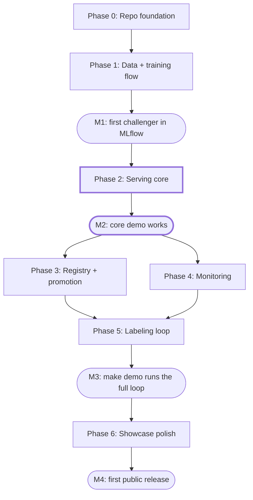

# CXR MLOps Implementation Plan v2

Last updated: 2026-10-27 · No deadlines: phases are ordered by dependency.

## Goal and definition of done

The project is done when someone who opens the repo can run `docker compose --profile core up`, upload a CXR image, and see probabilities and a CAM heatmap without training anything, and the `full` profile proves that the label → retrain → gate → promote → monitor loop works at least once.

- [ ] `core` starts with one command on a laptop without a GPU and ships with a seeded `@champion`
- [ ] `full` runs one scripted demo end to end: drift → Label Studio → new labels → new DVC rev → retrain → gate → approve → worker loads vN
- [ ] Every prediction traces back to its `model_version`, MLflow run, and DVC rev
- [ ] CI passes: unit tests, the E2E parity test, and the `core` smoke test
- [ ] README has a demo GIF, architecture diagram, quickstart, ADRs, measured RAM, and a disclaimer that this is not a medical device

| Profile | Services | Purpose |
| --- | --- | --- |
| `core` | Nginx, Web UI, Django, RabbitMQ, Celery worker, PostgreSQL, RustFS, MLflow | Upload → heatmap demo and promotion through Django admin |
| `full` | `core` + Prefect server/worker, Label Studio, Pushgateway, Prometheus, Alertmanager, Grafana | Full training, monitoring, and labeling loop |

Out of scope: clinical validation, a de-identification pipeline (the project uses an already de-identified public dataset), GPU training, Kubernetes, HA, and auth beyond Django's built-in.

## Build order

| Phase | What gets built | Ends with |
| --- | --- | --- |
| 0. Repo foundation | Compose `core`/`full` profiles, `cxr_core` package, CI; RustFS, MLflow, and DVC wired and tested | Every `core` service healthy |
| 1. Data + training flow | NIH subset, patient split, frozen locked test; train → eval → ONNX → E2E parity → reference → register | M1 |
| 2. Serving core | Django + Ninja, RabbitMQ, ONNX worker, Svelte UI; seeded `@champion`, upload → probabilities + CAM | M2 |
| 3. Registry + promotion | Paired bootstrap gate vs `@champion`, admin approve, alias move, fanout reload | Approval switches every worker to vN |
| 4. Monitoring | Evidently drift + delayed AUROC, Prometheus rules, Grafana, Alertmanager | Drift and stale alerts fire |
| 5. Labeling loop | Disagreements + drift → Label Studio, new DVC rev with ≥N labels → retrain | M3 |
| 6. Showcase polish | README + GIF, ADRs, model card, disclaimer, fresh-clone check | M4 |

M2 is the point where the repo is worth showing. If time runs out after that, skip straight to Phase 6. Phases 3 and 4 do not depend on each other, so their order is flexible.

Changes from v1: data and training are merged into one phase, backend and frontend are merged, promotion moves before monitoring, retraining is driven by labels instead of drift, and the Compose profiles are reduced to `core` / `full`.

## Phase 0: Repo foundation

Get a repo where `make up` starts all `core` infrastructure with health checks and CI runs lint and tests, before the first line of ML code. The layout below replaces v1's `src/cxr/` + `services/` + `infra/` layout; the tooling (uv, ruff, mypy, pytest, pre-commit) carries over.

- [x] Monorepo: `compose/`, `packages/cxr_core/`, `backend/`, `worker/`, `flows/`, `frontend/`, `data/`, `scripts/`, `docs/`
- [x] `docker-compose.yml` with `core` and `full` profiles (v1 had separate `monitoring` and `labeling` profiles), a healthcheck on every long-running service (one-shot `*-init` jobs use `service_completed_successfully` instead, see ADR 0002), and `depends_on: condition: service_healthy`
- [x] Postgres init creates 4 databases (app, mlflow, prefect, labelstudio) with a separate user per database
- [x] RustFS init job creates the `datasets`, `artifacts`, `inference`, and `mlflow` buckets plus a lifecycle rule for `inference/raw/`; every client reads the S3 endpoint from one set of env vars so the backend can be swapped
- [x] RabbitMQ with the management plugin, a `model.events` fanout exchange, and a DLQ
- [x] MLflow: Postgres backend store, RustFS artifact store
- [x] `cxr_core` skeleton: `preprocess` (no torch: numpy for the math, pydicom + Pillow for decoding and resampling; handles `MONOCHROME1`, linear windowing, rejecting VOI LUT sequences and non-LINEAR VOI functions, `preprocess_version`), `cam`, `metrics`; `[train]` extra = torch + timm
- [x] `Makefile`: `up`, `down`, `test`; `seed`, `train`, `demo` are stubs that exit 1 until Phases 1-2
- [x] uv workspace, ruff, mypy, pytest, pre-commit
- [x] GitHub Actions: lint, type check, unit tests
- [x] RustFS integration tests: put/get, multipart, presigned URL, MLflow artifact logging, DVC push/pull
- [x] Create `docs/adr/` and write each ADR as soon as the decision is made, starting with RustFS and the core/full profiles

**Done when** `make up` brings every `core` service to healthy, CI passes, and the RustFS integration tests pass.

## Phase 1: Data + training flow

`make seed && make train` on CPU produces the first `@challenger` that passes E2E parity, with thresholds and a drift reference tied to the model version, plus a seed bundle for `core`.

**Data**

- [x] `scripts/download_nih.py` selects a subset of NIH ChestX-ray14; no images are committed to the repo. Files come one by one from the public Kaggle mirror (`nih-chest-xrays/data`, no token), never the 42 GB of archives
- [x] Pick 5 to 6 classes with enough examples and record the reasoning in the model card: Atelectasis, Cardiomegaly, Effusion, Mass, Pneumothorax
- [x] Canonical schema from v1 (`image_id`, `patient_id`, `view_position`, `split`, label columns, `label_source`)
- [x] Split by patient (hash of `patient_id`, see ADR 0003); `test_locked/` is a separate, frozen DVC path, and new labels from Label Studio can only go into `curated/`
- [x] Small golden set with both PNG and DICOM, including at least one `MONOCHROME1` file to test inversion
- [x] Pandera schema: allowed values, image size, no patient shared across splits or with `test_locked/`
- [x] Prefect `ingest` flow: download → validate → `dvc add` + `dvc push` → load metadata into Postgres → record in `dataset_versions`

**Training**

- [x] Model factory in `cxr_core` accepts only architectures with a GAP + linear head and fails at build time otherwise (ADR 0004)
- [x] Config profiles: `demo` (128 px, ResNet18, small subset) and `full` (DenseNet121 or EfficientNet-B0), validated with pydantic
- [x] Prefect `train` flow: validate → build dataset (pin DVC rev) → train → evaluate → export ONNX → E2E parity → build reference → register
- [x] `make train` runs the flow without a Prefect server under `core` (confirmed: Prefect 3.9 starts a temporary local server) and through the server under `full` (the host process reports to `prefect-server`; a worker container that runs deployments comes with Phase 5)
- [x] Evaluate: per-class AUROC, sensitivity at fixed specificity, ECE, and subgroups (sex, age, view) on the locked test set and on the recent slice when available (the report has a `recent` slot that stays empty until Phase 5); write JSON + HTML reports to artifacts
- [x] Choose per-class thresholds on the validation set and store them with the model version, not in serving config
- [x] Export ONNX with 2 outputs (`logits`, `features`) and a dynamic batch axis
- [x] E2E parity: golden set from raw files → `cxr_core.preprocess` → ONNX vs PyTorch on probabilities, features, and CAM within tolerance
- [x] Build reference: embeddings, prediction distribution, and metadata distribution from the validation set as Parquet, logged as an artifact of the model version
- [x] Register with tags `dataset_rev`, `git_commit`, `preprocess_version`, `prefect_flow_run_id`, and thresholds, then set `@challenger`
- [x] `scripts/bootstrap_champion.py`: sets the first model as `@champion` and exports a seed bundle (ONNX + reference + thresholds) to attach to a GitHub Release

**Done when** `make seed && make train` finishes on CPU, MLflow has a version with all tags and artifacts, parity passes, and the seed bundle builds (**M1**).

## Phase 2: Serving core

This is the milestone the showcase needs: fresh clone → `make up` → `make seed-model` → upload an image in the UI and see probabilities and a CAM heatmap without training anything.

**Backend (Django + Ninja)**

- [ ] Apps: `jobs`, `feedback`, `registry`, `monitoring`
- [ ] Public API: `POST /api/jobs` (stores the file in `inference/raw/` → creates an `inference_job` → queues it), `GET /api/jobs/{id}`, `POST /api/jobs/{id}/feedback`
- [ ] Internal API (shared token): `POST /internal/results` and `GET /internal/champion`, which returns the current version
- [ ] Prediction rows store probabilities, the thresholds used, `model_version`, `preprocess_version`, heatmap path, and latency
- [ ] `/metrics` endpoint for Prometheus in Phase 4

**Queue + worker**

- [ ] Celery worker with no Django and no torch: `cxr_core.preprocess` → ONNX Runtime → CAM → `POST /internal/results`
- [ ] On startup, call `GET /internal/champion` and load vN from the artifacts bucket
- [ ] Subscribe to `model.events` with an exclusive queue and swap the ONNX session atomically after the current job finishes
- [ ] Retries, job timeout, and poison messages routed to the DLQ

**Frontend + gateway**

- [ ] Svelte + Vite: upload, job status, Cornerstone3D viewer with heatmap overlay and opacity slider, per-class probabilities with threshold markers, feedback form (agree or correct labels)
- [ ] "Not for clinical use" banner on every page
- [ ] Nginx: `/api` and `/admin` to the backend, `/` serves static files, rate limiting, and an upload size limit
- [ ] `make seed-model` downloads the seed bundle from the GitHub Release and registers it as `@champion`

**Done when** a fresh clone runs the three commands above, uploads an image from the golden set, shows the heatmap, and the prediction row has the correct `model_version`. A CI smoke test runs the same flow with `curl` (**M2**).

## Phase 3: Registry + promotion

`@challenger` replaces `@champion` only when it is not worse on the locked test set in a paired comparison and someone approves it in Django admin. All workers then switch to vN without dropping jobs.

- [ ] Gate task (end of the `train` flow or a separate `promotion` flow): runs champion and challenger on the same locked test set
- [ ] Paired bootstrap CI of ΔAUROC per class and macro; passes when the lower bound of macro ΔAUROC is not below −margin and no subgroup gets worse by more than the margin
- [ ] Other gate conditions: parity passed and ECE no worse than a set limit; all values live in `gate.yaml`
- [ ] Gate report (JSON + HTML) to artifacts, with status in `model_candidates`
- [ ] Django admin: shows the gate report, approve / reject / rollback actions, and records `model_approvals` (who, when, why)
- [ ] Approve: Django moves `@champion` to vN in MLflow, the old version gets `@previous`, and Django publishes `model.events` with vN
- [ ] Rollback: sets `@champion` back to `@previous` and publishes the same event
- [ ] `auto_promote` config flag (off by default) for the scripted demo
- [ ] Optional: shadow mode from the v1 plan (on the cut list)

**Done when** a second training run → the gate report appears in admin → approve → the next prediction from every worker has `model_version` = vN, and rollback works.

## Phase 4: Monitoring

The system sees infra health, drift, and real performance from feedback per `model_version`, and alerts on problems or when the monitor flow stalls, but never triggers retraining itself.

**System monitoring**

- [ ] Prometheus scrapes Django and the worker (`/metrics`: request latency, job failures, inference latency) and RabbitMQ through its Prometheus plugin
- [ ] Grafana dashboards as code (provisioning): serving, queue, and model per version
- [ ] Alert rules: API error rate, non-empty DLQ, missing worker, stale `monitor_last_success`, drift score above threshold
- [ ] Alertmanager sends to Discord or Slack through a webhook in `.env`

**Monitor flow (Prefect + Evidently)**

- [ ] Scheduled flow reads prediction windows per `model_version` from Postgres
- [ ] Evidently: embedding drift, prediction drift, and metadata drift against the current `@champion` reference
- [ ] Delayed AUROC from feedback that carries labels, reported with n and a CI, and not reported when n is below the configured minimum
- [ ] Push scores and `last_success_timestamp` to Pushgateway, store the HTML report in artifacts and a row in `drift_reports`
- [ ] Optional: per-image OOD flag in the worker from embedding distance to the reference, shown in the UI without triggering anything

**Demo tooling**

- [ ] `scripts/replay_traffic.py` sends validation images to the API
- [ ] `scripts/inject_drift.py` sends only a slice that differs from the reference, such as AP views only

**Done when** running `inject_drift.py` raises the drift score in Grafana and sends an alert to Discord, and stopping the monitor flow fires the stale alert.

## Phase 5: Labeling loop

Close the loop: drifted cases and cases where the model and the radiologist disagree reach Label Studio, labels return as a new dataset version, and retraining starts only when there are enough new labels, not when drift appears.

- [ ] Multi-label Label Studio project matching the canonical classes, with storage pointing at the `inference` bucket, not the DVC remote (file names in the remote are hashes)
- [ ] Monitor flow selects cases to label: (a) model disagrees with radiologist feedback, (b) top-k of drifted windows by embedding distance, (c) a small random sample to limit selection bias; creates tasks through the API without duplicates
- [ ] Export job: Label Studio → `labels` table (`label_source=reviewer`) → write to `curated/` → `dvc add` + `dvc push` → `dataset_versions`
- [ ] Protect the locked test set: Pandera checks that patients in new labels are not in `test_locked/`, and moves them to quarantine if they are
- [ ] Hold back part of the new labels as the recent slice for evaluation, never for training
- [ ] `should_retrain()`: new DVC rev and new labels ≥ N (config) → trigger the Prefect `train` deployment; log the decision whether or not it triggers
- [ ] `make demo`: scripted loop that uses the real NIH labels in place of a reviewer (inject drift → tasks → auto-label → DVC rev → retrain → gate → `auto_promote`)

**Done when** `make demo` plays the whole loop with no clicks, and every step leaves evidence in Label Studio, MLflow, Django admin, and Grafana (**M3**).

## Phase 6: Showcase polish

Someone new to the project should understand it and run `core` from one read of the README, since most visitors only see the README and the GIF.

- [ ] README: upload → heatmap GIF at the top, architecture diagram, three-command `core` quickstart, how to run `make demo`, measured RAM and disk for both profiles, limitations
- [ ] Complete ADRs: RustFS, core/full profiles, async queue, ONNX + CAM constraint, human gate, label-driven retraining
- [ ] Model card: data, classes, metrics with CIs, subgroups, limitations of the NIH labels
- [ ] "Not a medical device" disclaimer in the README, the UI, and the model card
- [ ] Code license and dataset citation/terms
- [ ] CI smoke test for `core` and the parity test run on every push to `main`
- [ ] Fresh-clone check: follow the README line by line on a machine that has never run the project (or a CI runner)

**Done when** a fresh clone following the README gets the `core` demo working with no extra questions, and the first release is tagged (**M4**).

## Testing strategy

Tests arrive with the phase that builds what they test. Unit, schema, parity, and API contract tests run on every push; the smoke test runs on `main`.

| Test | Covers | Runs | From phase |
| --- | --- | --- | --- |
| Unit | `cxr_core.preprocess` (`MONOCHROME1`, windowing), CAM, metrics, gate statistics, `should_retrain()` | Every push | 0 |
| Integration | RustFS, MLflow artifacts, DVC push/pull, `model.events` | Every push (services in CI) | 0 |
| Schema | Pandera, no patient shared across splits or with `test_locked/` | `ingest` flow + CI on a sample | 1 |
| E2E parity | Golden set from raw files → ONNX vs PyTorch (probabilities, features, CAM) | `train` flow + CI with a small model | 1 |
| API contract | Ninja endpoints, internal API auth | Every push | 2 |
| Smoke | `core` up → seed model → upload golden image → result with `model_version` | Push to `main` | 2 |
| Promotion | Approve → event → workers switch to vN, rollback | Manual workflow | 3 |
| Full loop | `make demo` | Before tagging a release | 5 |

## Risks and open decisions

The biggest risk is scope: if M2 is not done, the repo has nothing to show, so M2 comes before any monitoring or labeling work.

| Risk | Impact | Mitigation |
| --- | --- | --- |
| Scope grows until M2 slips | No demo to show | Follow the phase order; cut from the list below |
| RustFS is still prerelease and some S3 features may be incomplete | DVC or MLflow break | Integration tests in Phase 0; one S3 endpoint config so the backend can be swapped |
| CPU training is slow | Slow iteration | `demo` profile with 128 px + ResNet18 + small subset; cache on `dataset_rev + config_hash` |
| NIH labels are NLP-mined and noisy | Metrics look low or unconvincing | Report CIs, explain in the model card, pick classes with enough examples |
| Little feedback | Delayed AUROC is unstable | Minimum n and shown CIs |
| `full` needs more RAM than a typical laptop | Reviewers cannot run it | Measure and publish in the README; make `core` the main path |
| Preprocessing differs between training and serving | Probabilities and heatmaps are silently wrong | Shared `cxr_core` + E2E parity in CI |

**Cut list** (cut in this order if time runs short)

1. Shadow mode (keep the offline gate only)
2. Per-image OOD flag
3. Alertmanager (use Grafana alerting to Discord instead)
4. DICOM for the whole dataset (keep it for the golden set only)
5. Cornerstone3D (use a plain canvas with PNG + overlay)

**Open decisions**

- [ ] N for `should_retrain()` and the gate margin
- [x] Which 5 to 6 classes to use. Decided: Atelectasis, Cardiomegaly, Effusion, Mass, Pneumothorax (see the model card)
- [ ] NIH ChestX-ray14 terms for distributing model weights in a GitHub Release
- [x] Diagram v2 says `cxr_preprocess` while this plan uses `cxr_core` from v1; pick one name. Decided: `cxr_core` (diagram updated)
- [ ] Internal API auth (shared token or a separate network)
